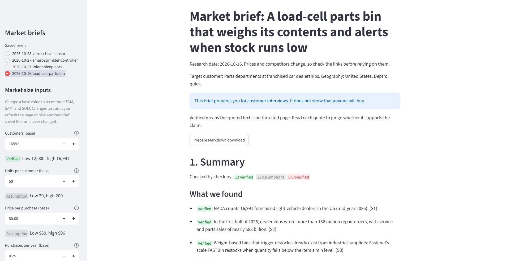

# Market Copilot

A Claude Code plugin that researches the market for a product idea and saves a sourced market
brief. Type one command:

```
/market-copilot:brief "A parts bin that weighs its contents and alerts when stock runs low"
```

and Claude Code searches the web, reads the pages, and saves a brief with:

1. a one-page summary: what it found, what is still unknown, and how many items were verified;
2. the riskiest assumptions, each with a way to test it;
3. a customer interview script that asks about past behavior;
4. competitors, with links and prices;
5. a bottom-up market size (TAM, SAM, SOM) computed from assumptions you can see and edit.

Every competitor, price, and market figure links to the page it came from, with the exact
quote. An optional viewer shows the brief with colored badges and lets you change the
market-size numbers. Try it on the sample briefs:
**[market-copilot.streamlit.app](https://market-copilot.streamlit.app)**.



Made by Josh Davis (BYU Marriott, Strategic Management).

## How it stays honest

These five rules are checked by code, not just asked of the model:

1. **No invented facts.** Every competitor, price, and market figure cites a source. Each
   source records the page's address, its title, and a short quote (25 words or fewer) copied
   exactly from the page.
2. **A script decides what is verified, not the model.** `copilot/check.py` loads every cited
   page and looks for the quote. An item is marked **Verified** only if each of its sources
   exists, the page loads, and the quote is on it. Otherwise it is marked **Unverified** and
   the reason is shown. Verified means the words are on the page; you still read the quote to
   judge whether it supports the claim.
3. **The model never states the market size.** It proposes each number (customers, units,
   price, purchases per year, shares) with a low, base, and high value. `copilot/sizing.py`
   does the multiplication, and you can change any number in the viewer.
4. **It prepares you for interviews; it doesn't prove demand.** The brief never claims anyone
   will buy. Interview questions ask "Tell me about the last time..." rather than "Would you
   buy...", and check.py flags any question that asks about a hypothetical.
5. **No API keys or paid services.** It runs on your own Claude plan. Making a brief needs only
   Python's standard library.

## What you need

- [Claude Code](https://code.claude.com/docs/en/overview) and a Claude plan that includes it.
  Briefs use your plan's usage and Claude Code's web search.
- Python 3.11 or newer, from [python.org](https://www.python.org/downloads/). On Windows,
  check "Add python.exe to PATH" when you install it.
- Only for the optional viewer: Streamlit (`python -m pip install streamlit`).

## Privacy

- **The brief command:** your idea is processed by Claude through your own Claude account,
  under Anthropic's terms, and parts of it appear in web search queries. The plugin's scripts
  load the pages Claude cites, so those sites see an ordinary page visit. The plugin sends
  nothing to Josh or to any server of his, and briefs are saved only on your computer, in
  `market-briefs/` in the folder you run it from.
- **The local viewer** (`/market-copilot:view`) runs on your computer at localhost only, with
  Streamlit's usage statistics turned off, so it sends nothing anywhere.
- **The public demo** (linked below) is hosted by Streamlit Community Cloud, which collects
  its own usage statistics under Streamlit's terms. It shows only the sample briefs in this
  repo, never your briefs.

## Install

In Claude Code, run these two commands:

```
/plugin marketplace add joshlamontdavis-a11y/market-copilot
/plugin install market-copilot@market-copilot
```

Or the same two steps from a terminal:

```
claude plugin marketplace add joshlamontdavis-a11y/market-copilot
claude plugin install market-copilot@market-copilot
```

## Make a brief

Open Claude Code in the folder where you want your briefs saved, then run:

```
/market-copilot:brief "<your product idea>"
```

Name the target customer, the geography, and a price guess in the idea if you can; if any of
them is missing, Claude asks (at most three questions). The default depth is quick (about
3-5 competitors and 10 sources). For more, add `--deep` (about 5-8 competitors and 15 sources):

```
/market-copilot:brief "<your product idea>" --deep
```

While it runs, the skill is allowed to search the web, run the plugin's own two scripts, and
save files in `market-briefs/` without asking each time; anything else still asks you. When it
finishes, it reports how many items are verified, assumptions, or unverified, and where the
brief is: `market-briefs/<date>-<short-name>/brief.md`, which you can read in any text editor.

## Open the viewer

```
/market-copilot:view
```

This starts the viewer on your briefs and gives you its address (usually
http://localhost:8501). Pick a brief in the sidebar. Change a base value under "Market size
inputs" and TAM, SAM, and SOM update; changed values are marked "Your edit", last until you
refresh the page, and never change your saved files. "Prepare Markdown download" saves the brief
with your numbers. To open a different folder: `/market-copilot:view <folder>`.

## Sample briefs

- **[Sample briefs](samples/README.md):** four real runs (a load-cell parts bin, an infant
  vital-signs sock, a smart sprinkler controller, and a beehive mite sensor).
- **[Public demo viewer](https://market-copilot.streamlit.app):** the four samples in the
  viewer, nothing to install. Change a market-size number to see TAM, SAM, and SOM update.
- **[Backtest results](backtest/RESULTS.md):** three of the samples describe past products
  whose outcomes are public, and RESULTS.md compares what each brief found with what really
  happened. **This is not a blind test.** Web search can find the real companies, so a brief
  may find the very company it describes. It shows what a brief surfaces, not that it can
  predict an unknown market.

## For developers

```
python -m venv .venv
.venv\Scripts\python -m pip install -r requirements-dev.txt
.venv\Scripts\python -m pytest
claude plugin validate .
```

(On macOS or Linux, use `.venv/bin/python`.) The tests never touch the live web. To try the
plugin without installing it, run `claude --plugin-dir <path to this repo>` from another folder.
To open the samples in the viewer: `streamlit run app.py -- samples backtest/runs`.

| Path | What it is |
|---|---|
| `skills/brief/SKILL.md` | the research workflow and the brief.json format |
| `skills/view/SKILL.md` | starts the viewer |
| `copilot/sources.py` | fetches a page as plain text and looks for a quote |
| `copilot/check.py` | checks every source, computes sizing, writes brief.md |
| `copilot/sizing.py` | TAM, SAM, and SOM from the assumptions |
| `copilot/render.py` | turns the brief and check results into brief.md |
| `copilot/viewer.py`, `app.py` | the viewer's logic and its Streamlit page |
| `demo/streamlit_app.py` | the public demo of the samples |

## License

[MIT](LICENSE), copyright Josh Davis.
